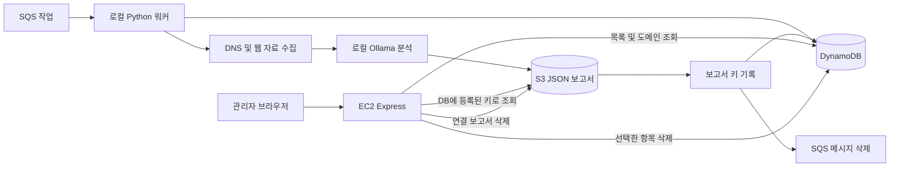
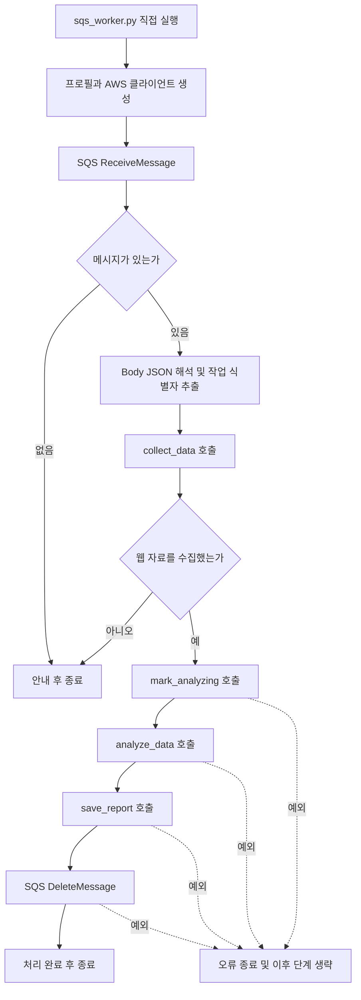
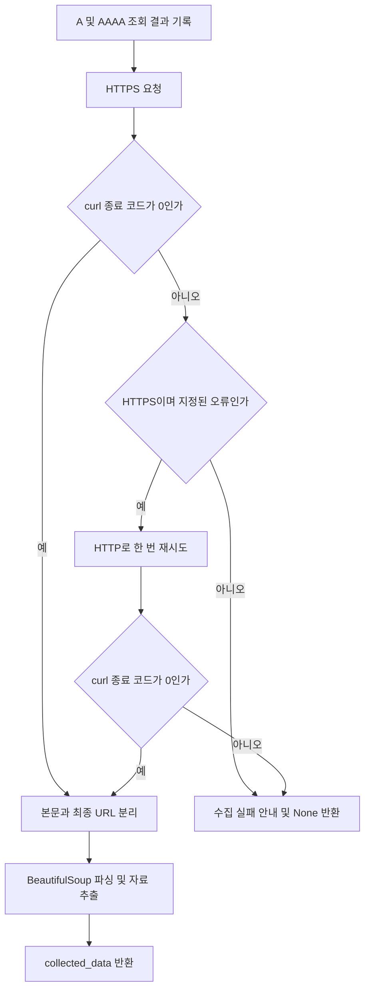
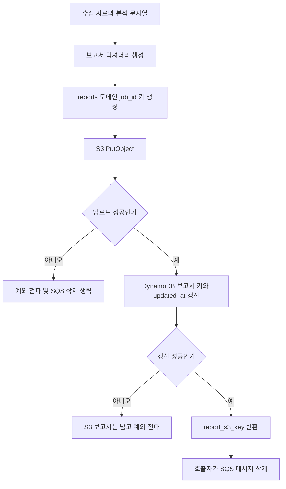
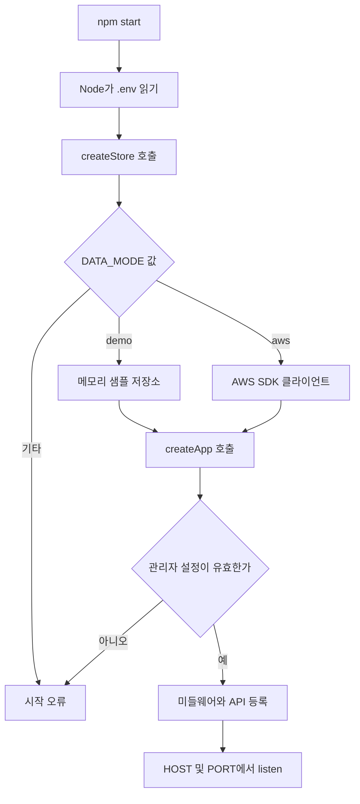
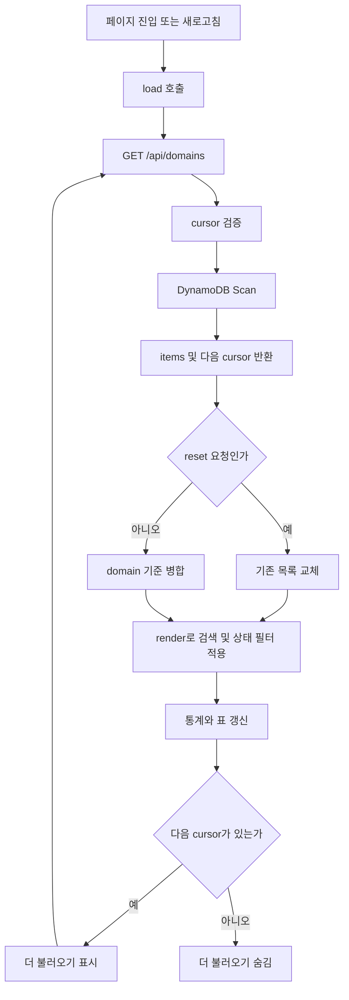
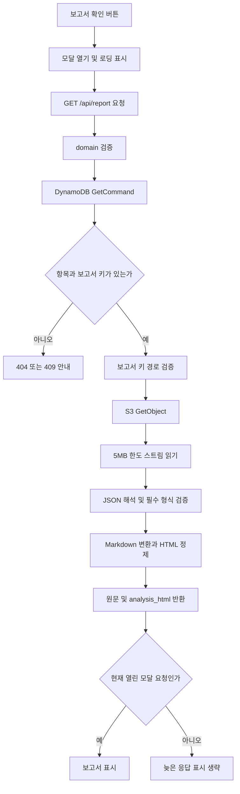
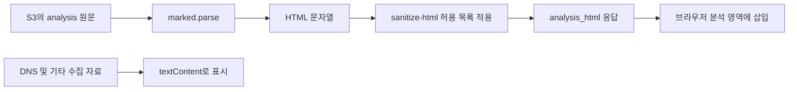
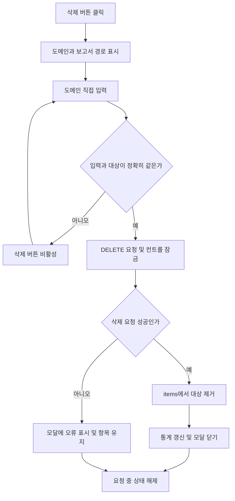
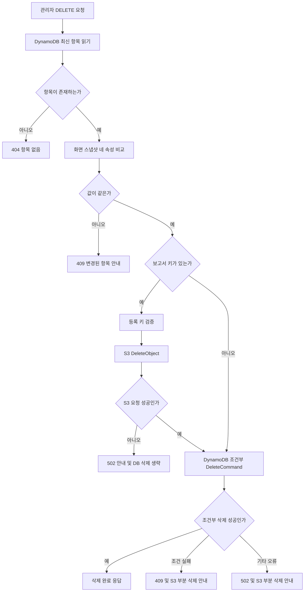

# DNS 분석 워커 및 관리자 대시보드 코드 상세 설명서

작성일: 2026-10-25, 한국 시간 기준이다.

분석 기준은 로컬 `dns_project/python_file`과 `dns_project/dns-admin-dashboard`의 실제 저장된 코드다. 이 문서는 프로그램을 처음 읽는 사람이 자료가 어디서 생성되고, 어떤 함수를 거쳐 저장되며, 대시보드에서 어떻게 조회하고 삭제하는지 따라갈 수 있도록 작성한다.

문서 작성은 소스 읽기와 로컬 테스트를 기준으로 한다. EC2 배포 버전, 실시간 IAM 설정, 실제 S3 버전 관리 여부, SQS 표시 제한 시간은 이 문서 작성 중 직접 조회하지 않는다. 따라서 코드의 설정과 실제 AWS 환경이 일치하는지는 별도로 확인해야 한다.

## 목차

1. [전체 구조와 구현 범위](#1-전체-구조와-구현-범위)
2. [파일 구성과 의존 관계](#2-파일-구성과-의존-관계)
3. [자료 구조와 식별자](#3-자료-구조와-식별자)
4. [Python 워커의 전체 실행](#4-python-워커의-전체-실행)
5. [DNS 및 웹 수집 로직](#5-dns-및-웹-수집-로직)
6. [Ollama 분석 요청](#6-ollama-분석-요청)
7. [DynamoDB 갱신과 S3 저장](#7-dynamodb-갱신과-s3-저장)
8. [SQS 메시지 삭제](#8-sqs-메시지-삭제)
9. [Express 시작과 요청 처리](#9-express-시작과-요청-처리)
10. [관리자 인증과 입력 검증](#10-관리자-인증과-입력-검증)
11. [도메인 목록 조회와 페이지 처리](#11-도메인-목록-조회와-페이지-처리)
12. [S3 보고서 조회](#12-s3-보고서-조회)
13. [Markdown 변환과 표시](#13-markdown-변환과-표시)
14. [프런트엔드 상태와 이벤트](#14-프런트엔드-상태와-이벤트)
15. [삭제 확인 모달과 요청](#15-삭제-확인-모달과-요청)
16. [S3 및 DynamoDB 삭제 상세](#16-s3-및-dynamodb-삭제-상세)
17. [오류와 부분 성공 처리](#17-오류와-부분-성공-처리)
18. [환경변수와 IAM 권한](#18-환경변수와-iam-권한)
19. [실행 및 검증 방법](#19-실행-및-검증-방법)
20. [현재 한계와 후속 작업](#20-현재-한계와-후속-작업)
21. [코드를 읽는 순서와 수정 위치](#21-코드를-읽는-순서와-수정-위치)

## 1. 전체 구조와 구현 범위

### 1.1 프로그램 두 개의 역할

Python 워커는 분석 결과를 만드는 프로그램이다. SQS 작업을 받아 DNS와 웹 자료를 수집하고, 로컬 Ollama에 분석을 요청한다. 결과는 S3 보고서와 DynamoDB 보고서 위치로 남긴 뒤 SQS 메시지를 삭제한다.

Express 대시보드는 저장된 결과를 읽고 관리하는 프로그램이다. DynamoDB에서 목록을 읽고, 확인 버튼을 누르면 해당 항목의 `report_s3_key`로 S3 보고서를 읽는다. 삭제 버튼은 지정한 DynamoDB 항목과 연결 보고서 한 개를 삭제한다.

대시보드가 열릴 때 Python 워커를 실행하거나 AI 분석을 다시 요청하지 않는다. 두 프로그램은 DynamoDB와 S3에 저장된 자료로 연결된다.



위 그림의 DynamoDB와 S3 연결선은 별도 서비스 호출을 의미한다. 두 서비스가 자동으로 동기화하거나 하나의 트랜잭션으로 움직인다는 의미는 아니다.

### 1.2 구현한 기능과 계획한 기능

| 구분 | 현재 상태 |
|---|---|
| SQS 작업 하나 수신 | Python에서 구현한다. |
| DNS와 정적 웹 자료 수집 | Python에서 구현한다. |
| 로컬 LLM 분석 | `qwen3.5:9b`를 호출한다. |
| `Analyzing` 상태 기록 | 분석 요청 직전에 기록한다. |
| S3 JSON 보고서 저장 | 구현한다. |
| DynamoDB 보고서 키 기록 | S3 업로드 성공 후 구현한다. |
| SQS 메시지 삭제 | 저장 함수 성공 후 구현한다. |
| 관리자 인증 | Express의 HTTP Basic 인증을 사용한다. |
| 도메인 목록과 보고서 모달 | 구현한다. |
| AI 분석 Markdown 표시 | 정제한 HTML로 표시한다. |
| 항목과 연결 보고서 삭제 | 구현한다. |
| 연속 실행과 병렬 분석 | 현재 저장된 워커에는 구현하지 않는다. |
| 위험 점수와 최종 판정 | 현재 분석 코드는 구조화된 판정 값을 생성하지 않는다. |
| 분석 완료 상태 변경 | 현재 저장 함수는 구현하지 않는다. |
| 평판 API, 차단 승인, RPZ 반영 | 현재 대시보드에는 구현하지 않는다. |

상태 필터에 `review`, `blocked`가 있다고 해서 대시보드가 해당 상태를 자동 생성하거나 실제 RPZ 반영을 확인한다는 의미는 아니다. 현재는 저장된 값을 표시하는 기능이다.

## 2. 파일 구성과 의존 관계

```text
dns_project/
├── python_file/
│   ├── sqs_worker.py
│   ├── collector.py
│   ├── analyzer.py
│   ├── storage.py
│   └── README.md
└── dns-admin-dashboard/
    ├── server.js
    ├── app.js
    ├── store.js
    ├── markdown.js
    ├── public/
    │   ├── index.html
    │   ├── app.js
    │   └── style.css
    ├── test/
    │   ├── markdown.test.js
    │   ├── delete.test.js
    │   └── delete-ui.test.js
    ├── .env.example
    ├── .gitignore
    ├── package.json
    ├── package-lock.json
    ├── ec2-read-policy.json
    ├── README.md
    └── CODE_LOGIC.md
```

| 파일 | 책임과 주요 함수 |
|---|---|
| `python_file/sqs_worker.py` | `main()`에서 작업의 실행 순서를 결정한다. |
| `python_file/collector.py` | `collect_data()`가 DNS와 웹 자료를 반환한다. |
| `python_file/analyzer.py` | `analyze_data()`가 Ollama 분석 문자열을 반환한다. |
| `python_file/storage.py` | `mark_analyzing()`과 `save_report()`가 DynamoDB와 S3에 기록한다. |
| `server.js` | 환경변수를 읽고 저장소와 Express 앱을 생성한 뒤 포트를 연다. |
| `app.js` | 인증, 입력 검증, API 경로, 정적 파일과 오류 응답을 관리한다. |
| `store.js` | `createStore()`로 샘플 또는 AWS 자료 접근 함수를 생성한다. |
| `markdown.js` | `renderAnalysis()`가 AI 분석 문자열을 정제한 HTML로 변환한다. |
| `public/index.html` | 목록, 검색, 통계, 보고서 모달과 삭제 모달의 뼈대를 정의한다. |
| `public/app.js` | API 호출, 화면 렌더링, 모달과 버튼 이벤트를 관리한다. |
| `public/style.css` | Grayish Lavender, White, Cobalt Green 화면과 반응형 배치를 정의한다. |
| `ec2-read-policy.json` | EC2 역할의 조회 및 삭제 권한 예시를 제공한다. 파일명은 기존 이름을 유지한다. |
| `package.json` | Node.js 요구 버전, 실행 명령과 직접 의존성을 정의한다. |
| `package-lock.json` | 실제 설치할 의존성 버전을 고정하며 `npm ci`에서 사용한다. |
| `.env.example` | 설정 항목만 제공한다. 실제 관리자 비밀번호를 포함하지 않는다. |
| `.gitignore` | `.env`와 `node_modules/`를 Git에서 제외한다. |

서버의 `app.js`와 브라우저의 `public/app.js`는 이름만 같고 실행 위치가 다르다. 전자는 Node.js에서 실행하며 AWS 호출 권한을 가진다. 후자는 브라우저에서 실행하며 Express API만 호출한다.

### 2.1 직접 의존성

| 구분 | 라이브러리 또는 실행 파일 | 역할 |
|---|---|---|
| Python | boto3다. | AWS API를 호출한다. |
| Python | dnspython이다. | DNS 레코드를 조회한다. |
| Python | beautifulsoup4다. | 정적 HTML에서 자료를 추출한다. |
| 외부 프로그램 | curl이다. | HTTP와 HTTPS 요청 및 리다이렉트를 처리한다. |
| 로컬 서비스 | Ollama다. | 설치한 모델의 분석 API를 제공한다. |
| Node.js | express다. | HTTP 서버와 라우트를 제공한다. |
| Node.js | helmet이다. | 응답 보안 헤더를 구성한다. |
| Node.js | express-rate-limit다. | 실패 요청의 속도를 제한한다. |
| Node.js | AWS SDK v3 DynamoDB와 S3 클라이언트다. | AWS 요청 명령을 전송한다. |
| Node.js | @aws-sdk/lib-dynamodb다. | 일반 JavaScript 객체와 DynamoDB 자료형 변환을 처리한다. |
| Node.js | marked와 sanitize-html이다. | Markdown을 HTML로 변환하고 허용한 서식만 남긴다. |

Python의 json, tempfile, pathlib, urllib, datetime과 Node.js의 crypto, url, test, assert는 표준 라이브러리다. 별도 npm 또는 pip 패키지로 설치하지 않는다.

## 3. 자료 구조와 식별자

### 3.1 `domain`

`domain`은 현재 코드가 사용하는 DynamoDB 파티션 키다. 현재 코드는 정렬 키 없는 domain 단일 키 테이블을 전제로 하므로 같은 도메인에 대한 여러 분석을 별도 항목으로 저장하지 않는다. 이 문서 작성 중 실제 테이블 스키마를 조회하지는 않는다.

Python은 SQS 본문의 `domain`을 사용한다. 대시보드는 DynamoDB의 `domain`을 목록 식별자와 단건 조회 키로 사용한다.

### 3.2 `job_id`

`job_id`는 특정 분석 작업을 구별한다. 현재 워커는 이 값을 생성하거나 검증하지 않고 SQS 본문에서 받는다. 따라서 작업 ID 생성 방식은 메시지를 보내는 상위 프로그램의 책임이다.

```json
{
  "domain": "example.com",
  "job_id": "sample-job-001"
}
```

위 예시는 메시지 본문 형식을 설명하기 위한 자료다. 실제 작업 ID 값이나 실행 결과를 의미하지 않는다.

### 3.3 `report_s3_key`

`report_s3_key`는 버킷 이름을 제외한 객체 키다.

```text
버킷: dns-analysis-reports-994899741506-ap-northeast-2-an
키: reports/example.com/sample-job-001.json
```

Python과 대시보드는 같은 버킷 설정을 사용해야 한다. DynamoDB 항목에는 버킷 이름을 별도로 저장하지 않으므로 대시보드가 잘못된 버킷을 사용하면 키가 맞아도 보고서를 읽을 수 없다.

S3에서 `/`는 객체 키의 일부다. 콘솔에서는 폴더처럼 보이지만 서버 파일 시스템의 디렉터리를 생성하는 동작은 아니다.

### 3.4 DynamoDB 항목

```json
{
  "domain": "example.com",
  "status": "Analyzing",
  "created_at": "2026-10-25T00:00:00+00:00",
  "updated_at": "2026-10-25T00:05:00+00:00",
  "report_s3_key": "reports/example.com/sample-job-001.json"
}
```

| 속성 | 생성 및 사용 위치 |
|---|---|
| `domain` | SQS와 DB에 이미 있는 값을 워커와 대시보드가 키로 사용한다. 등록 소스는 별도 확인 범위다. |
| `created_at` | 워커 외부에서 제공되는 값을 사용하며, 현재 워커는 생성하거나 변경하지 않는다. |
| `status` | 워커가 분석 직전에 `Analyzing`으로 변경한다. 대시보드는 표시 및 삭제 비교에 사용한다. |
| `updated_at` | 분석 시작과 보고서 위치 기록 시 UTC 문자열로 갱신한다. |
| `report_s3_key` | S3 업로드 성공 뒤 워커가 기록하며 대시보드가 보고서 조회에 사용한다. |

이 문서는 등록 Lambda 소스를 분석하지 않으므로 `created_at`의 실제 생성 코드와 등록 시점의 모든 속성은 다루지 않는다.

### 3.5 수집 자료 `collected_data`

| 필드 | 내용 |
|---|---|
| `domain`, `job_id` | 수신한 작업 식별자를 담는다. |
| `dns` | A와 AAAA 조회 상태 및 레코드를 담는다. |
| `requested_url` | 성공한 웹 요청의 최초 URL을 담는다. HTTP로 재시도하여 성공했다면 HTTP 주소를 담는다. |
| `final_url` | curl이 리다이렉트를 따라간 최종 URL을 담는다. |
| `headers` | 중간 리다이렉트 응답을 포함할 수 있는 헤더 문자열을 담는다. |
| `title` | HTML 제목을 담는다. |
| `script_urls` | 외부 스크립트 `src` 원문 목록을 담는다. |
| `links` | 링크의 표시 문구, 원본 주소와 전체 URL을 담는다. |
| `forms` | 폼의 원본 전송 주소, 전체 URL과 메서드를 담는다. |
| `body_text` | script와 style 등을 제거한 뒤 추출한 본문 텍스트를 담는다. |

### 3.6 S3 보고서

```json
{
  "domain": "example.com",
  "job_id": "sample-job-001",
  "analyzed_at": "2026-10-25T00:05:00+00:00",
  "collected_data": {
    "domain": "example.com",
    "job_id": "sample-job-001",
    "title": "Example",
    "final_url": "https://example.com/",
    "dns": {},
    "links": [],
    "forms": [],
    "script_urls": [],
    "headers": "",
    "body_text": "수집 본문 예시"
  },
  "analysis": "## 분석 결과\n\n제공된 자료만으로 판단할 수 없다."
}
```

`analyzed_at`은 저장 함수에서 보고서 딕셔너리를 만드는 시각이다. LLM 내부의 정확한 분석 시작 또는 종료 계측값은 아니다. 예시의 수집 자료 일부는 설명을 위해 생략한다.

`analysis_html`은 이 S3 원본에 저장하지 않는다. 대시보드가 보고서를 조회할 때 생성하는 응답 필드다.

## 4. Python 워커의 전체 실행

### 4.1 실행 진입점

`sqs_worker.py` 마지막의 `if __name__ == "__main__": main()`으로 시작한다. 다른 파일에서 모듈을 가져올 때는 `main()`을 실행하지 않는다.

현재 파일에는 `while True`나 백그라운드 서비스 설정이 없다. 실행 한 번에 메시지 하나를 처리하고 종료한다. 과거 대화에서 반복문을 설명한 것과 현재 파일에 반복문이 구현된 것은 별개다.



수신이나 메시지 해석, 수집 중 예상하지 못한 예외도 잡지 않으므로 오류 종료할 수 있다. 그림은 주요 저장 및 분석 경계의 오류 경로를 중심으로 표시한다.

### 4.2 인증과 클라이언트 생성

`boto3.Session(profile_name="dns-project")`를 만든 뒤 같은 세션에서 SQS, DynamoDB, S3 클라이언트를 생성한다. 리전은 모두 `ap-northeast-2`다.

SQS 수신값은 다음과 같다.

```python
response = sqs.receive_message(
  QueueUrl=QUEUE_URL,
  MaxNumberOfMessages=1,
  WaitTimeSeconds=20
)
```

`MaxNumberOfMessages=1`은 한 번에 작업 하나를 요청한다. `WaitTimeSeconds=20`은 메시지가 없을 때 수신 요청이 최대 20초 대기하는 롱 폴링 설정이다. AI 분석 제한 시간이나 SQS 표시 제한 시간을 설정하는 값은 아니다.

### 4.3 메시지 해석과 함수 호출

`response.get("Messages", [])`로 메시지 배열을 얻는다. 빈 배열이면 안내를 출력하고 `return`한다. 그 후 `messages[0]`을 `message`로 보관하고 `Body`를 `json.loads()`로 해석한다.

`message` 전체를 보관하는 이유는 마지막 삭제 단계에서 본문 밖에 있는 `ReceiptHandle`이 필요하기 때문이다. 본문만 보관하면 수신 작업을 삭제할 핸들을 잃는다.

현재는 `domain`, `job_id` 누락 또는 잘못된 JSON에 대한 별도 복구가 없다. `JSONDecodeError`나 `KeyError`가 나면 이후 저장과 삭제는 진행하지 않는다.

`collect_data()`가 `None`을 반환하면 AI를 호출하지 않고 종료한다. 정상 딕셔너리라면 수집 내용을 `ensure_ascii=False`, `indent=2`로 출력하고 다음 단계로 이동한다.

## 5. DNS 및 웹 수집 로직

소스는 `python_file/collector.py`이며 공개 함수는 `collect_data(domain, job_id)`다. 반환값은 수집 딕셔너리 또는 `None`이다.

### 5.1 DNS 조회

`{"A", "AAAA"}`를 순회한다. 집합을 사용하므로 두 유형의 조회 순서를 고정하지 않는다.

도메인은 `domain.rstrip(".") + "."`로 마지막 점을 맞추고 `search=False`로 조회한다. 시스템 검색 접미사를 붙여 다른 이름을 조회하는 것을 피하려는 설정이다.

DNS 서버 주소는 코드에서 직접 지정하지 않는다. Python 실행 환경의 기본 Resolver 설정을 사용하므로 Rocky DNS로 직접 조회한다고 가정하지 않는다.

각 유형은 `lifetime=5`를 사용한다. 성공하면 `status="ok"`와 `answer.to_text()` 결과 배열을 저장한다. `dns.exception.DNSException`이면 예외 클래스 이름, 빈 레코드 배열, 오류 문자열을 저장하고 다른 유형의 조회를 계속한다.

DNS 조회 실패가 곧 웹 수집 중단을 의미하지는 않는다. 이후 curl은 별도로 주소를 해석하여 요청한다. 앞서 얻은 IP로 curl 대상을 고정하거나 일치 여부를 검증하지 않는다.

### 5.2 curl 실행과 HTTP 재시도



| 옵션 | 현재 코드에서의 의미 |
|---|---|
| `-q` | curl 기본 설정 파일 영향을 줄인다. |
| `-sS` | 진행 표시를 숨기고 오류는 출력한다. |
| `-L` | 리다이렉트를 따라간다. |
| `-D` | 헤더를 임시 파일에 기록한다. |
| `--proto =http,https` | 요청에 사용할 프로토콜을 제한한다. |
| `--proto-redir =http,https` | 리다이렉트 프로토콜도 제한한다. |
| `--max-redirs 5` | 리다이렉트 횟수를 제한한다. |
| `--max-time 15` | 요청별 제한 시간을 설정한다. |
| `--max-filesize 2000000` | curl에 본문 크기 제한을 설정한다. |
| `--write-out` | 본문 뒤에 줄바꿈과 최종 URL을 출력한다. |

실행은 인자 배열을 사용하며 `shell=True`를 사용하지 않는다. stdout과 stderr는 UTF-8로 읽고 해석할 수 없는 바이트는 대체 문자로 처리한다.

재시도 대상 종료 코드는 `7, 28, 35, 52, 56, 60`이다. HTTPS에서 이 코드가 나올 때만 HTTP로 한 번 재시도한다. HTTP 요청 실패 뒤에는 추가 재시도를 하지 않는다.

curl에 `--fail`을 사용하지 않는다. 따라서 HTTP 403, 404, 500 응답도 curl 전송이 성공했다면 수집 가능한 응답으로 처리한다. HTTP 응답 코드와 curl 프로세스 종료 코드는 다른 값이다.

### 5.3 임시 헤더 파일과 URL 분리

각 요청에서 `TemporaryDirectory()`를 만들고 내부의 `headers.txt`로 헤더를 받는다. 컨텍스트가 끝나기 전에 파일을 `headers_data`에 읽으므로 임시 디렉터리가 제거된 뒤에도 문자열은 남는다.

헤더 파일이 없으면 빈 문자열을 사용한다. 헤더를 구조화된 딕셔너리로 파싱하지는 않는다.

curl stdout의 마지막 줄바꿈을 `rsplit("\n", 1)`로 한 번 분리한다. 앞부분은 원본 HTML이고 뒷부분은 최종 URL이다. HTML 안의 줄바꿈은 유지한다.

### 5.4 HTML 추출 순서

1. `BeautifulSoup(web_data, "html.parser")`로 HTML을 해석한다.
2. `script[src]`의 주소를 먼저 수집한다.
3. script와 style 태그, stylesheet 링크, 인라인 style 속성을 제거한다.
4. 최종 URL과 `base[href]`로 상대 주소 해석 기준을 정한다.
5. 링크의 텍스트, 원본 href, 결합한 URL을 수집한다.
6. 폼의 원본 action, 전체 URL, 메서드를 수집한다.
7. 제목과 본문 텍스트를 수집한다.
8. 수집 결과를 하나의 딕셔너리로 반환한다.

스크립트 주소는 `strip()`만 수행하므로 상대 주소가 남을 수 있다. 링크는 `urljoin(base_url, href)`로 전체 주소를 만든다. 폼 action이 비어 있으면 `base_url`이 아니라 현재 페이지의 `final_url`을 사용한다.

링크 텍스트는 `get_text(" ", strip=True)`로 조각 사이 공백을 넣는다. 본문은 `get_text("\n", strip=True)`로 줄바꿈을 넣는다. body 태그가 없으면 soup 전체에서 본문을 추출한다.

응답의 Content-Type이 HTML인지 검사하지 않으며 전송받은 본문을 HTML 파서에 넣는다. 원본 HTML 전체는 수집 함수의 지역 변수로만 사용하고 반환 딕셔너리나 S3 보고서에 별도 저장하지 않는다.

이 함수는 폼의 입력 필드 목록을 추출하지 않는다. 따라서 비밀번호 입력란 유무가 별도 자료로 제공된다고 가정하면 안 된다. JavaScript 실행, 외부 스크립트 본문 수집, 링크 방문, 폼 제출도 수행하지 않는다.

## 6. Ollama 분석 요청

소스는 `python_file/analyzer.py`이며 함수는 `analyze_data(collected_data)`다.

요청은 `http://localhost:11434/api/chat`에 POST한다. `Content-Type`은 `application/json`이며 JSON을 UTF-8 바이트로 변환한다.

| 항목 | 값과 의미 |
|---|---|
| `model` | `qwen3.5:9b`를 사용한다. |
| `stream` | `False`이므로 분석 응답 전체를 읽은 후 반환한다. |
| system 메시지 | 자료의 지시문을 따르지 않고 근거와 한계를 설명하도록 지시한다. |
| user 메시지 | 수집 딕셔너리를 JSON 문자열로 전달한다. |
| `timeout` | `urlopen()`에 300초 타임아웃을 설정한다. 작업 전체의 300초 완료를 보장하는 별도 타이머는 아니다. |

`json.load(response)`로 응답 JSON을 읽고 `ai_response["message"]["content"]`를 반환한다. 현재 응답 형식 검증이나 별도 재요청은 없다. JSON 형식이나 필수 필드가 다르면 예외가 발생할 수 있다.

system 지침은 확인하지 않은 IP 평판이나 등록 정보를 추측하지 않도록 요구한다. 외부 링크, 리다이렉트, 보안 헤더 부재만으로 악성을 단정하지 않도록 요구한다. 이것은 모델에 전달하는 지침이며, 코드가 모든 출력의 사실성을 검증한다는 의미는 아니다.

이 모듈은 위험 점수 계산, 50~100개 룰 적용, 자동 차단 결정을 수행하지 않는다. 반환값은 자유 형식 분석 문자열이다.

## 7. DynamoDB 갱신과 S3 저장

소스는 `python_file/storage.py`다. AWS 클라이언트는 함수 내부에서 새로 만들지 않고 워커에서 전달받는다.

### 7.1 `mark_analyzing(dynamodb, domain)`

PK를 다음과 같이 지정한다.

```python
Key={
  "domain": {"S": domain}
}
```

이 코드는 Boto3의 저수준 DynamoDB 클라이언트를 사용한다. `{"S": ...}`는 문자열 타입을 명시한다. 대시보드의 JavaScript DocumentClient가 일반 문자열을 사용하는 것과 표현 방식이 다르다.

갱신식은 `SET #status = :status, updated_at = :updated_at`이다. `#status`는 속성 이름 별칭이고 `:status`는 값 자리표시자다.

조건식은 `attribute_exists(#domain)`이다. 기존 항목이 있을 때만 갱신하므로 도메인을 새로 생성하지 않는다. 현재 상태가 `Queued`인지, 현재 작업이 같은 `job_id`인지 확인하는 조건은 없다.

따라서 이름은 분석 시작 기록이지만, 정확히는 AI HTTP 요청 직전에 상태를 기록한다. Ollama가 요청을 수락했다는 서버 응답을 받은 뒤 기록하는 구조는 아니다.

### 7.2 `save_report(s3, dynamodb, domain, job_id, collected_data, analysis)`



보고서는 `json.dumps(..., ensure_ascii=False, indent=2).encode("utf-8")`로 직렬화한다. 로컬 JSON 파일을 생성하지 않고 `Body`에 바이트를 전달한다. `ContentType`은 `application/json; charset=utf-8`이다.

S3 성공 후 DynamoDB의 `report_s3_key`와 `updated_at`만 갱신한다. 조건은 기존 항목의 존재 여부다. `status`는 변경하지 않는다.

보고서 위치 갱신에 실패하면 `return`하지 않으므로 호출자는 성공으로 처리하지 않고 SQS 삭제에도 도달하지 않는다. 이미 올라간 S3 객체를 되돌려 삭제하는 로직은 없다.

같은 도메인과 작업 ID는 같은 객체 키로 업로드한다. 버전 관리 설정에 따라 덮어쓰거나 새 버전이 생길 수 있으므로, 같은 키를 쓴다고 S3 비용이나 과거 버전이 항상 하나만 남는다고 단정하지 않는다.

### 7.3 현재 상태 해석

보고서 키가 존재하면서 `status=Analyzing`인 항목이 나올 수 있다. 현재 저장 로직에서 정상적으로 가능한 조합이다.

대시보드의 보고서 버튼은 `status`가 아니라 `report_s3_key` 존재 여부를 본다. 따라서 이 상태에서도 보고서를 볼 수 있다. 반면 분석 대기 및 진행 통계에는 계속 포함된다.

보고서가 존재한다는 사실과 분석 정책의 최종 판정 상태를 분리해서 해석해야 한다.

## 8. SQS 메시지 삭제

`save_report()`가 반환한 뒤 워커가 다음 요청을 수행한다.

```python
sqs.delete_message(
  QueueUrl=QUEUE_URL,
  ReceiptHandle=message["ReceiptHandle"]
)
```

`ReceiptHandle`은 특정 수신 시도의 핸들이다. 도메인, 작업 ID, `MessageId`와 다르다. 같은 메시지를 다시 수신하면 새 핸들을 얻으므로 최신 수신의 핸들로 삭제해야 한다. 오래된 핸들은 요청이 성공한 것처럼 보여도 실제 삭제되지 않을 수 있다. [AWS DeleteMessage 문서](https://docs.aws.amazon.com/AWSSimpleQueueService/latest/APIReference/API_DeleteMessage.html)

표시 제한 시간 동안 메시지는 다른 수신 요청에서 숨겨진다. 처리 완료 전에 그 시간이 지나면 재수신될 수 있다. 현재 코드는 `ChangeMessageVisibility`를 호출하거나 처리 중 자동 연장하지 않는다.

현재 워커는 저장된 `report_s3_key`를 먼저 읽어 작업 완료 여부를 검사하지 않는다. SQS 삭제 실패나 재수신이 발생하면 자료 수집과 AI 분석을 다시 실행할 수 있다.

| 상황 | SQS 삭제 호출 여부 |
|---|---|
| 메시지가 없음 | 호출하지 않는다. |
| 웹 수집이 실패하여 `None`을 반환함 | 호출하지 않는다. |
| 분석 시작 상태 갱신이 실패함 | 호출하지 않는다. |
| AI 요청 또는 응답 처리가 실패함 | 호출하지 않는다. |
| S3 저장이 실패함 | 호출하지 않는다. |
| S3 성공 후 DynamoDB 갱신이 실패함 | 호출하지 않는다. |
| 저장과 갱신이 모두 성공함 | 수신 핸들로 호출한다. |
| 삭제 요청이 실패함 | 저장 결과는 남고 메시지는 재처리될 수 있다. |

## 9. Express 시작과 요청 처리

### 9.1 `server.js`

`npm start`는 `node --env-file=.env server.js`를 실행한다. `.env`를 읽는 주체는 이 Node.js 실행 옵션이다. `server.js` 자체에서 dotenv 라이브러리를 호출하지 않는다.

순서는 다음과 같다.

1. `createStore(process.env)`로 자료 접근 객체를 생성한다.
2. `createApp()`에 저장소와 관리자 설정을 전달한다.
3. `HOST`와 `PORT`를 읽는다.
4. `app.listen()`으로 서버를 시작한다.



`createStore()`의 AWS 클라이언트 생성은 실제 보고서를 읽는 것과 다르다. 서버 시작 로그가 출력됐다고 AWS 권한과 네트워크 경로가 검증된 것은 아니다. 실제 요청에서 자격증명 탐색과 서비스 호출이 실패할 수 있다.

### 9.2 `createApp()` 미들웨어 순서

| 순서 | 처리 |
|---|---|
| 1 | `X-Powered-By`를 비활성화한다. |
| 2 | Helmet으로 보안 관련 응답 헤더를 설정한다. |
| 3 | `Cache-Control: no-store`를 설정한다. |
| 4 | 요청 속도 제한 미들웨어를 실행한다. |
| 5 | HTTP Basic 인증을 확인한다. |
| 6 | 목록, 보고서 조회, 삭제 API를 처리한다. |
| 7 | `public/`의 정적 파일을 제공한다. |
| 8 | 경로가 없으면 JSON 404를 반환한다. |
| 9 | 발생한 예외를 공통 오류 응답으로 변환한다. |

정적 HTML과 CSS, 브라우저 JavaScript도 인증 뒤에서 제공한다. 화면 주소만 보호하고 API를 외부에 열어 두는 구조는 아니다.

### 9.3 API 요약

| 메서드와 경로 | 입력 | 호출 함수 | 정상 응답 |
|---|---|---|---|
| `GET /api/domains` | 선택적인 `cursor` 쿼리다. | `store.list(cursor)`를 호출한다. | `items`, `cursor`, `mode`를 반환한다. |
| `GET /api/report` | `domain` 쿼리다. | `store.report(domain)`과 `renderAnalysis()`를 호출한다. | 원본 보고서와 `analysis_html`을 반환한다. |
| `DELETE /api/domains` | 헤더와 JSON 본문이다. | `store.remove(domain, expected)`를 호출한다. | `domain`, `report_deleted`를 반환한다. |

등록, 상태 변경, 평판 조회, RPZ 반영 API는 현재 없다.

## 10. 관리자 인증과 입력 검증

### 10.1 시작 시 설정 검증

사용자명이 비어 있거나 `:`를 포함하면 오류를 발생시킨다. 비밀번호가 없거나 JavaScript 문자열 길이가 12 미만이어도 시작하지 않는다.

12자 기준은 현재 코드의 문자열 길이 조건이다. 복잡도나 유출 비밀번호 여부를 별도로 확인하는 기능은 아니다.

### 10.2 HTTP Basic 인증

`Authorization`이 `Basic `으로 시작하면 뒷부분을 Base64에서 UTF-8로 해석한다. 첫 번째 `:`를 기준으로 사용자명과 비밀번호를 나눈다.

서버는 입력과 설정값을 각각 SHA-256 해시로 만든 뒤 `timingSafeEqual()`로 비교한다. 비교할 바이트 길이를 일정하게 만들기 위한 처리다. 비밀번호를 해시 파일이나 DB에 저장하는 계정 관리 기능은 아니며, 실제 설정값은 환경변수에 있다.

인증 실패 시 `WWW-Authenticate`와 401 응답을 반환한다. 브라우저는 기본 인증 창을 띄우고 자격증명을 기억할 수 있다. 현재 명시적인 로그아웃이나 세션 만료 기능은 없다.

HTTP Basic의 Base64는 암호화가 아니다. 외부 접속은 HTTPS 또는 SSH 터널을 사용해야 한다. 이 문서의 설명은 구현의 인증 방식과 배포 전제를 구분한다.

### 10.3 요청 제한과 응답 캐시

현재 제한 설정은 15분 구간에서 20회이며 `skipSuccessfulRequests=true`를 사용한다. 이 미들웨어는 인증뿐 아니라 전체 경로 앞에 있으므로 인증 실패 외에 실패한 API 응답도 제한에 반영될 수 있다.

성공 응답은 집계에서 제외되며, 제한 초과 시 기본적으로 429 응답과 안내 문자열을 반환한다. 제한 저장소는 기본 메모리 저장소이므로 프로세스 재시작과 여러 프로세스 사이에 공유되지 않는다.

`Cache-Control: no-store`는 화면과 API 응답을 캐시에 저장하지 않도록 요청한다. 이미 실행 중인 브라우저 JavaScript를 자동으로 최신 코드로 바꾸는 기능은 아니므로 정적 파일을 갱신했다면 페이지를 새로고침한다.

### 10.4 도메인과 커서 검증

`validDomain()`은 문자열 여부, 최대 253자, 소문자 영문과 숫자, 점, 하이픈으로 이루어진 대략적인 형식을 검사한다. 배열형 쿼리나 경로 문자열 등은 거절한다.

실제 DNS 존재 여부, 레이블별 길이, 연속된 점, IDN 변환까지 검증하는 완전한 DNS 이름 검증기는 아니다. 서버에서 자동 소문자 변환도 수행하지 않는다.

### 10.5 삭제 요청 보호

삭제 API는 다음 조건을 확인한다.

- `X-Requested-With`가 `DNSAdmin`이어야 한다.
- `Sec-Fetch-Site`가 `cross-site`이면 거절한다.
- `domain`이 형식 검증을 통과해야 한다.
- `confirmation`이 `domain`과 정확히 같아야 한다.
- `expected`에 네 개의 비교 속성이 모두 있어야 한다.
- 비교값은 `null` 또는 길이 2048 이하의 문자열이어야 한다.

인증이 통과한 다음 DELETE 경로에만 `express.json({ limit: "4kb" })`를 적용한다. 잘못된 JSON이나 본문 크기 초과는 현재 공통 처리에서 400으로 반환한다.

사용자 정의 헤더가 있는 DELETE는 브라우저의 교차 출처 요청에서 사전 요청이 필요하다. 현재 앱은 이를 허용하는 CORS 설정을 제공하지 않는다. 고정 헤더 자체가 비밀 토큰이거나 비브라우저 클라이언트를 차단하는 인증 수단은 아니다.

## 11. 도메인 목록 조회와 페이지 처리

### 11.1 `store.list(cursor)`

AWS 모드에서는 `ScanCommand`로 테이블을 읽는다. `Limit=50`이며 다음 속성만 응답에 요청한다.

```text
 domain
 created_at
 report_s3_key
 status
 updated_at
```

`ProjectionExpression`은 화면에 필요하지 않은 속성까지 전송하지 않도록 한다. 읽기 비용이 속성 개수에 단순 비례해서 줄어든다는 보장은 아니다.

Scan은 한 번에 평가한 항목 수 제한과 1MB 응답 처리 경계를 따른다. 따라서 항상 50개가 반환된다고 가정하지 않는다. 목록 읽기에 `ConsistentRead=true`는 설정하지 않는다. [AWS Scan 문서](https://docs.aws.amazon.com/amazondynamodb/latest/APIReference/API_Scan.html)



### 11.2 커서의 생성과 전달

반환값의 `LastEvaluatedKey.domain`을 다음 커서로 사용한다. 다음 요청은 `ExclusiveStartKey: { domain: cursor }`를 전달한다.

이 방식은 PK가 `domain` 하나라는 현재 테이블 구조에 맞춘 구현이다. 정렬 키를 추가하거나 인덱스를 사용하면 커서 구조도 함께 변경해야 한다.

### 11.3 브라우저 병합과 검색

`load(true)`는 목록을 새 응답으로 교체한다. `load()`는 이전 목록과 새 목록을 합친 뒤 Map의 키를 `domain`으로 하여 중복을 제거한다. 중복 도메인의 값은 새 페이지의 값으로 교체한다.

검색과 상태 필터는 서버 검색이 아니다. 이미 메모리에 불러온 `items` 배열을 대상으로 `render()`에서 처리한다. 더 불러오지 않은 도메인은 검색 결과에 나타나지 않는다.

검색어는 앞뒤 공백을 제거하고 소문자로 만든다. 항목의 도메인은 원래 값을 사용하므로 상위 단계에서 정규화된 도메인이 저장된다는 전제가 있다.

### 11.4 통계의 의미

| 통계 | 실제 계산 |
|---|---|
| 불러온 도메인 | `items.length`를 표시한다. |
| 분석 대기 및 진행 | `pending_enqueue`, `Queued`, `Analyzing` 항목 수를 표시한다. |
| 검토 대기 | `status=review`인 항목 수를 표시한다. |
| 보고서 등록 | `report_s3_key`가 참으로 평가되는 항목 수를 표시한다. |
| 표 옆 항목 수 | 검색과 상태 필터를 통과한 `visible.length`를 표시한다. |

상단 통계는 필터 결과가 아니라 불러온 전체 목록 기준이다. 또한 보고서 등록 수는 S3 객체의 존재를 검사한 결과가 아니다.

## 12. S3 보고서 조회

### 12.1 조회 시점

목록을 열 때 S3 보고서를 모두 가져오지 않는다. `report_s3_key`가 있는 행의 확인 버튼을 눌렀을 때만 조회한다.



그림의 경로 검증, S3 호출, 크기 검사, JSON 처리에서 발생한 오류도 모달 안내로 전달한다.

### 12.2 DynamoDB 단건 읽기

`GetCommand({ TableName, Key: { domain }, ConsistentRead: true })`를 사용한다. 목록에서 본 키를 브라우저가 그대로 S3에 전달하게 하지 않고, 서버가 DynamoDB에서 최신 항목을 다시 읽는다.

항목이 없으면 404, `report_s3_key`가 비어 있으면 409를 반환한다. 이 단건 읽기는 강한 일관성을 요청하지만 이후 S3 읽기까지 하나의 스냅샷으로 묶지는 않는다.

### 12.3 보고서 키 검증

`reportKey(domain, key)`는 다음을 확인한다.

1. 문자열이어야 한다.
2. `reports/${domain}/`로 시작해야 한다.
3. `.json`으로 끝나야 한다.

브라우저는 임의의 버킷이나 키를 선택할 수 없다. 버킷은 서버 환경변수에서 읽는다.

이 검증은 시작 경로와 확장자 확인이며, 작업 ID 형식이나 중간 경로 깊이까지 강제하지는 않는다. S3 객체 키는 파일 경로와 다르므로 파일 시스템의 경로 정규화로 설명하지 않는다.

### 12.4 S3 스트림과 크기 제한

`GetObjectCommand`가 반환한 `Body`를 `for await`로 읽는다. 각 청크의 바이트 수를 합산하고 `5 * 1024 * 1024`를 넘으면 스트림을 중단하고 413을 발생시킨다.

정상 범위라면 `Buffer.concat(chunks).toString("utf8")`로 문자열을 만든다. 서버 디스크에 보고서 파일을 저장하지 않는다.

S3가 `NoSuchKey`를 반환하면 보고서 없음 404로 변환한다. 권한 오류 등 나머지는 일반 AWS 요청 실패 502로 처리한다. 객체가 없더라도 권한 조합에 따라 S3가 다른 오류를 반환할 수 있으므로 모든 누락 상황이 동일한 404 안내로 보장되지는 않는다.

### 12.5 JSON 최소 검증

다음 조건을 검사한다.

- 최상위 보고서가 존재해야 한다.
- `report.domain`이 요청한 도메인과 같아야 한다.
- `analysis`가 문자열이어야 한다.
- `collected_data`가 배열이 아닌 객체여야 한다.

`job_id`, `analyzed_at`, 개별 링크와 폼 필드의 상세 형식까지 검증하지 않는다. 전체 보고서 스키마 검증기로 구현한 것은 아니다.

## 13. Markdown 변환과 표시

`GET /api/report`는 `store.report()`의 결과를 받은 뒤 `renderAnalysis(report.analysis)`를 호출한다.



### 13.1 변환 옵션

`marked.parse(markdown, { gfm: true, breaks: true })`를 사용한다. 표와 취소선 등 GFM 문법을 해석하고 일반 줄바꿈을 표시용 줄바꿈으로 처리한다.

Markdown 변환 자체는 안전한 HTML 정제를 의미하지 않는다. 따라서 변환 결과를 다시 sanitize-html로 정제한다.

### 13.2 허용하는 서식

허용 태그는 문단, 줄바꿈, 굵게, 기울임, 취소선, h1~h6, 목록, 인용, 코드, 구분선, 표 관련 태그다. `allowedAttributes`는 빈 객체이므로 모든 HTML 속성을 허용하지 않는다.

링크 태그와 이미지 태그는 허용하지 않는다. 링크의 텍스트는 남을 수 있지만 클릭 가능한 href는 남지 않는다. script, iframe, 이벤트 속성, 임의 style과 id도 표시용 출력에 남지 않도록 정제한다.

### 13.3 브라우저 삽입 지점

`analysis_html`이 문자열이면 해당 값만 `analysis.innerHTML`에 넣는다. 없으면 분석 원문을 `textContent`로 표시한다. 원본 분석 문자열을 직접 `innerHTML`에 넣지 않는다.

DNS와 본문, 헤더, 링크 목록 등은 `element()`의 `textContent`로 넣는다. 따라서 수집 자료가 HTML처럼 생겨도 문서 요소로 실행하지 않는다.

S3 원본의 `analysis`는 수정하지 않는다. 화면 표시 형식을 바꾸기 위해 기존 보고서를 다시 업로드할 필요는 없다.

## 14. 프런트엔드 상태와 이벤트

### 14.1 전역 상태

| 변수 | 역할 |
|---|---|
| `items` | 현재 브라우저에 불러온 도메인 목록을 보관한다. |
| `cursor` | 다음 페이지를 조회할 도메인 커서를 보관한다. |
| `selected` | 보고서 모달에서 선택한 도메인을 보관한다. |
| `requestId` | 보고서 응답이 현재 요청인지 구별한다. |
| `deleteTarget` | 삭제 모달을 열 때의 행 스냅샷을 보관한다. |
| `deleting` | 삭제 요청이 진행 중인지 표시한다. |
| `listing` | 목록 요청이 진행 중인지 표시한다. |
| `listRequestId` | 목록 응답이 최신 요청인지 구별한다. |

### 14.2 보조 함수

| 함수 | 동작 |
|---|---|
| `$` | ID로 DOM 요소를 찾는다. |
| `date()` | 유효한 시각을 한국 시간 문자열로 바꾸고, 없거나 잘못되면 대시를 표시한다. |
| `element()` | 요소를 생성하고 텍스트와 클래스를 지정한다. |
| `api()` | fetch를 호출하고 JSON 또는 오류를 반환한다. |
| `render()` | 현재 배열을 필터링하여 통계와 표를 다시 생성한다. |
| `load()` | 목록 조회와 페이지 병합을 처리한다. |
| `addSection()` | 제목과 pre 요소로 텍스트 자료 구역을 만든다. |
| `openReport()` | 보고서 모달을 열고 조회 결과를 표시한다. |
| `openDelete()` | 삭제 모달과 대상 스냅샷을 준비한다. |

### 14.3 `render()`의 행 구성

행은 domain, created_at, report_s3_key, status, updated_at, 보고서, 삭제의 7개 칸이다. 보고서 키가 길면 CSS 말줄임 표시와 title 속성으로 원문을 제공한다.

보고서 키가 있으면 확인 버튼을 만든다. 없으면 `Analyzing`일 때 분석 진행 중, 나머지는 보고서 위치 미등록을 표시한다. 삭제 버튼은 목록을 읽는 중이거나 다른 삭제를 처리하는 중이면 비활성화한다.

빈 목록은 등록된 도메인 없음, 검색으로 걸러진 빈 결과는 조건에 맞는 도메인 없음으로 구분한다.

### 14.4 요청 경쟁 처리

목록 요청마다 `listRequestId`를 증가시키고 성공 응답의 ID가 최신인지 확인한다. 오래된 성공 응답은 목록을 덮어쓰지 않는다. 다만 현재 `catch`에는 같은 ID 검사가 없어, 오래된 실패 안내까지 완전히 차단하는 구조는 아니다.

보고서 요청도 `requestId`를 증가시킨다. 성공 응답은 ID가 최신이고 모달이 열려 있을 때만 표시한다. 모달을 닫을 때 ID를 다시 증가시켜 늦은 응답을 무효화한다.

이 방식은 요청 자체를 네트워크에서 취소하지 않는다. `AbortController`로 S3 또는 fetch를 취소하는 구현은 없다. 표시만 생략하므로 이미 시작된 서버 호출은 끝까지 진행될 수 있다.

### 14.5 보고서 모달 닫기

보고서 모달은 네이티브 `dialog.showModal()`을 사용한다. 닫기 버튼, Escape, 모달 경계 바깥 클릭을 처리한다. 네이티브 모달의 기본 포커스 동작을 사용한다.

닫으면 선택 상태를 초기화하고 표를 다시 만든다. 선택했던 도메인의 확인 버튼이 있으면 그곳으로 포커스를 돌리고, 없으면 검색 입력으로 이동한다.

### 14.6 이벤트 연결

| 요소 또는 이벤트 | 호출과 결과 |
|---|---|
| 검색 입력 | `render()`로 로컬 필터를 다시 계산한다. |
| 상태 select 변경 | `render()`로 상태 필터를 적용한다. |
| 새로고침 | `load(true)`로 목록을 교체한다. |
| 더 불러오기 | `load()`로 다음 페이지를 병합한다. |
| 도메인 현황 메뉴 | 상태 필터를 비우고 제목과 `aria-pressed`를 바꾼다. |
| 검토 대상 메뉴 | 상태 필터를 `review`로 지정한다. 서버의 별도 페이지를 호출하지 않는다. |
| 확인 버튼 | `openReport(domain)`을 호출한다. |
| 삭제 버튼 | `openDelete(item)`을 호출한다. |

상태 배지는 `failed`와 과거 오타인 `faild`를 모두 처리 실패로 표시한다. 다만 select에는 `failed`만 있고 필터는 문자열을 정확히 비교하므로 `faild`는 해당 필터 결과에 포함하지 않는다. 알려지지 않은 상태는 원문을 표시하며 상태 자체가 없으면 미등록으로 표시한다.

현재 자동 주기 갱신은 없다. 상태가 바뀌어도 사용자가 새로고침하지 않으면 이전 목록이 보일 수 있다. 메뉴의 선택 표시도 수동 select 변경과 완전히 동기화하는 별도 로직은 없다.

### 14.7 스타일과 접근성

페이지 배경, 통계 카드와 보고서 모달은 White를 기본으로 하고 사이드바는 흰색에 가까운 #FBFAFC를 사용한다. Grayish Lavender는 선택 메뉴, 표 헤더와 코드 서식 등 작은 영역에 #F5F1F9로 적용한다. Cobalt Green은 버튼과 선택 표시, 포커스의 강조색으로 사용한다. 작은 버튼의 흰색 글자 대비를 위해 기본 녹색보다 어두운 버튼 색을 사용한다.

기능상 필요한 오류, 샘플 자료 구분, 시간대와 필터 범위는 남긴다. 검색과 select에는 화면 낭독기용 label을 제공하고, 모달 제목과 상태 안내에는 aria 속성을 사용한다.

표는 좁은 화면에서 가로 스크롤하며, 640px 이하에서는 탐색을 위쪽으로 배치한다. CSS에 해당 구성이 존재한다는 것과 실제 브라우저별 렌더링 검증을 완료했다는 것은 다르다.

### 14.8 보고서 JSON과 실제 표시 구역

`openReport()`는 서버 응답을 받은 뒤 DOM 요소를 생성하고 마지막에 detail 영역의 자식을 한 번에 교체한다. 보고서 원문을 기존 HTML 템플릿에 단순 문자열 치환하는 구조는 아니다.

| 화면 구역 | 참조 필드 | 실제 표시 방식 |
|---|---|---|
| 모달 제목 | 요청한 domain이다. | 도메인과 분석 보고서 문구를 결합한다. |
| 분석 시각 | `analyzed_at`이다. | 한국 시간으로 변환하고 KST를 붙인다. |
| AI 분석 결과 | `analysis_html` 또는 `analysis`다. | 정제된 HTML을 우선 표시하며 없으면 원문을 텍스트로 표시한다. |
| 페이지 제목 | `collected_data.title`이다. | facts의 dd 요소에 넣는다. |
| 최종 URL | `collected_data.final_url`이다. | 클릭 가능한 링크가 아닌 텍스트로 표시한다. |
| 작업 ID | `job_id`다. | facts에 표시한다. |
| DNS 조회 결과 | `collected_data.dns`다. | JSON 들여쓰기 2칸으로 pre에 표시하며 없으면 빈 객체를 표시한다. |
| 수집 본문 | `collected_data.body_text`다. | pre에 텍스트로 표시하며 없으면 본문 없음 문구를 표시한다. |
| 링크와 폼 | `links`, `forms`다. | details 안에 JSON으로 표시한다. |
| 스크립트 주소 | `script_urls`다. | details 안에 JSON으로 표시한다. |
| 응답 헤더 | `headers`다. | 문자열은 그대로 표시한다. |

접기 구역의 값이 문자열이 아니면 `JSON.stringify(value || [], null, 2)`를 사용한다. 따라서 응답 헤더 값이 없을 때도 빈 문자열 대신 빈 배열 모양으로 보일 수 있다. 현재 코드의 표시 규칙이며 원본 JSON 스키마를 강제하는 처리와는 다르다.

## 15. 삭제 확인 모달과 요청

### 15.1 확인 모달을 여는 시점

`openDelete(item)`은 `deleting` 또는 `listing`이 참이면 종료한다. 그렇지 않으면 행 객체를 얕게 복사하여 `deleteTarget`에 보관한다.

모달에는 도메인과 등록된 S3 키를 표시한다. 키가 없으면 등록된 보고서 없음으로 안내한다. 사용자는 도메인을 정확히 입력해야 하며 앞뒤 공백 제거 또는 소문자 자동 변환은 하지 않는다.



### 15.2 요청 본문

```json
{
  "domain": "example.com",
  "confirmation": "example.com",
  "expected": {
    "status": "Analyzing",
    "created_at": "2026-10-25T00:00:00+00:00",
    "updated_at": "2026-10-25T00:05:00+00:00",
    "report_s3_key": "reports/example.com/sample-job-001.json"
  }
}
```

값이 없는 속성은 `null`로 보낸다. 서버는 이 네 개의 값을 DB 최신 항목과 비교한다. 사용자가 본 항목과 다른 항목으로 바뀌었는데 그대로 삭제하는 것을 줄이기 위한 처리다.

보고서 키를 본문에 넣더라도 그 값으로 S3를 직접 삭제하지 않는다. 실제 삭제 키는 서버가 DynamoDB에서 다시 읽은 값을 사용한다.

### 15.3 요청 중 잠금과 완료 처리

요청 중에는 중복 submit, 목록 새로고침, 다른 삭제 버튼, 확인 입력과 취소를 막는다. Escape로 발생하는 `cancel` 이벤트도 요청 중에는 `preventDefault()`로 막는다.

삭제 모달에는 보고서 모달과 같은 배경 클릭 닫기 핸들러가 없다. 요청 전에는 취소 버튼과 네이티브 Escape로 닫고, 요청 중에는 완료를 기다린다.

성공하면 현재 `items`에서 해당 도메인을 제거하고 통계를 다시 계산한다. 서버 목록 전체를 즉시 다시 조회하지는 않는다. 실패하면 항목을 유지하고 오류를 모달 안에 표시한다.

삭제 성공 응답이 네트워크에서 유실되면 서버는 삭제했지만 브라우저에는 실패가 보일 수 있다. 이 경우 목록을 새로고침하여 실제 상태를 확인한다.

## 16. S3 및 DynamoDB 삭제 상세

함수는 `store.remove(domain, expected)`다. 이 함수는 S3와 DynamoDB를 각각 호출하며 자동 롤백이나 분산 트랜잭션은 구현하지 않는다.

### 16.1 삭제 순서



보고서 키 검증 실패도 422로 종료하며 어떤 삭제도 진행하지 않는다. 보고서가 없는 항목의 DynamoDB 삭제 실패에는 S3 부분 삭제 문구를 붙이지 않는다.

### 16.2 삭제 전 스냅샷 비교

`snapshotFields`는 `status`, `created_at`, `updated_at`, `report_s3_key`다. `checkSnapshot()`은 최신 항목의 값과 브라우저가 보낸 `expected`를 비교한다.

비교 시 `item[field] ?? null`을 사용하여 없는 값과 null을 맞춘다. 비교 실패는 S3 삭제 전이므로 서버는 두 저장소를 변경하지 않고 409를 반환한다.

### 16.3 보고서가 없는 항목

코드는 `report_s3_key`가 undefined 또는 null일 때 보고서가 없다고 본다. 이 경우 S3를 호출하지 않고 DynamoDB만 삭제한다.

빈 문자열은 위 두 값과 다르므로 보고서 키 검증에서 422가 된다. 따라서 잘못된 빈 키를 정상 경로로 취급하여 삭제하지 않는다.

### 16.4 S3를 먼저 삭제하는 이유와 범위

DynamoDB를 먼저 지운 뒤 S3 삭제에 실패하면 보고서 위치를 DB에서 잃을 수 있다. 현재는 S3를 먼저 삭제하여 S3 오류 시 DB 경로를 남기는 쪽으로 처리한다.

이 순서가 전체 삭제를 원자적으로 만드는 것은 아니다. S3 성공 후 DB 오류가 나면 보고서가 없는 DB 항목이 남을 수 있다.

삭제 대상은 `report_s3_key` 한 개다. 같은 도메인 prefix의 다른 작업 보고서나 키가 등록되지 않은 객체를 검색하여 지우지는 않는다.

S3 버전 관리가 활성화된 버킷에서 VersionId 없는 DeleteObject는 일반적으로 삭제 마커를 만든다. 현재 코드는 과거 버전을 열거하거나 영구 삭제하지 않는다. [AWS DeleteObject 문서](https://docs.aws.amazon.com/AmazonS3/latest/API/API_DeleteObject.html)

정상 DeleteObject 응답은 삭제 요청 완료를 의미한다. 객체가 이미 없었던 경우에도 성공할 수 있으므로 `report_deleted=true`는 서버가 등록된 키에 삭제 요청을 성공적으로 수행했다는 의미로 해석한다.

### 16.5 DynamoDB 조건부 삭제

서버는 S3 삭제 전 읽었던 스냅샷으로 조건식을 만든다.

```text
attribute_exists(#domain)
AND #field0 = :value0
AND #field1 = :value1
AND #field2 = :value2
AND #field3 = :value3
```

원래 속성이 없으면 해당 비교는 `attribute_not_exists(#fieldN)`으로 바꾼다. 존재하지 않는 값에 undefined를 비교값으로 전달하지 않는다.

| 별칭 | 실제 속성 |
|---|---|
| `#domain` | `domain`이다. |
| `#field0` | `status`다. |
| `#field1` | `created_at`이다. |
| `#field2` | `updated_at`이다. |
| `#field3` | `report_s3_key`다. |

조건은 DeleteCommand 시점에 평가한다. 항목이 사라지거나 이 네 속성이 달라지면 삭제를 거절한다. 그 외 임의 속성의 변화나 동일한 값으로 재생성된 항목까지 모두 감지하는 버전 번호 검증은 아니다.

### 16.6 부분 실패와 동시 워커

S3 삭제 뒤 조건이 실패하면 이미 완료된 S3 삭제를 되돌리지 않는다. 응답은 409 또는 502와 함께 S3 삭제 완료 사실을 알린다.

분석 워커가 동시에 같은 키에 보고서를 업로드하면 S3 삭제와 경쟁할 수 있다. 현재 대시보드는 워커 잠금이나 SQS 취소 기능을 구현하지 않는다. 삭제할 때 해당 워커를 중지하라는 안내는 이 실제 한계에서 나온 운영 절차다.

항목을 삭제해도 SQS 메시지나 RPZ 정책은 남는다. 이후 DNS 로그가 들어오면 상위 등록 로직이 같은 도메인을 신규 항목으로 만들 수 있다. 삭제는 허용 예외 등록이나 영구 재분석 방지 기능이 아니다.

## 17. 오류와 부분 성공 처리

### 17.1 `AppError`

`AppError`는 일반 Error에 HTTP 상태 코드인 `status`를 붙인다. 의도한 사용자 안내는 이 클래스로 생성한다.

공통 오류 미들웨어는 AppError의 상태와 메시지는 그대로 반환한다. 예상하지 못한 오류는 502와 일반 안내로 변환하고 서버 로그에는 `error.name`을 남긴다. AWS 오류 전문이나 자격증명을 응답에 넣지 않는다.

### 17.2 HTTP 상태별 처리

| 코드 | 발생 예시와 표시 |
|---|---|
| 400 | 도메인 또는 커서 형식 오류, 확인값 불일치, expected 누락, JSON 오류를 표시한다. |
| 401 | 관리자 인증을 요구한다. 본문은 JSON이 아닌 인증 안내 문자열이다. |
| 403 | 삭제 보호 헤더 누락 또는 cross-site 요청을 표시한다. |
| 404 | 도메인 항목, S3 보고서 또는 API 경로가 없음을 표시한다. |
| 409 | 보고서 키 미등록, 삭제 전후 항목 변경을 표시한다. |
| 413 | 읽은 S3 보고서가 5MiB를 넘었음을 표시한다. |
| 422 | 잘못된 S3 키, JSON 해석 또는 보고서 최소 형식 오류를 표시한다. |
| 429 | 실패 요청 제한에 도달했음을 표시한다. |
| 502 | AWS 요청 오류 또는 삭제 부분 실패를 표시한다. |

브라우저 `api()`는 401을 먼저 특별 처리하고 나머지는 JSON으로 읽는다. 속도 제한의 429처럼 JSON이 아닌 본문이 오면 JSON 해석 오류 문자열이 보일 수 있다. 모든 비정상 HTTP 응답을 균일하게 해석하는 구현은 아니다.

### 17.3 저장 실패 매트릭스

| 실패 단계 | S3 상태 | DynamoDB 상태 | 큐 처리 |
|---|---|---|---|
| AI 호출 실패 | 이번 보고서를 새로 저장하지 않는다. | 이미 `Analyzing`일 수 있다. | 메시지를 삭제하지 않는다. |
| S3 저장 실패 | 업로드 실패 결과에 따라 확인이 필요하다. | 보고서 위치 갱신 전이다. | 메시지를 삭제하지 않는다. |
| 보고서 위치 갱신 실패 | 업로드한 보고서가 남는다. | 새 경로가 반영되지 않을 수 있다. | 메시지를 삭제하지 않는다. |
| SQS 삭제 실패 | 보고서가 남는다. | 보고서 위치가 기록된다. | 재수신될 수 있다. |

네트워크 오류는 서버 측 요청 결과를 완전히 알 수 없는 경우가 있으므로 예외가 났다는 이유만으로 쓰기가 절대 발생하지 않았다고 단정하지 않는다.

### 17.4 대시보드 삭제 실패 매트릭스

| 실패 단계 | S3 | DynamoDB | 다음 확인 |
|---|---|---|---|
| 인증 및 입력 검증 | 호출하지 않는다. | 삭제하지 않는다. | 입력과 권한을 확인한다. |
| 첫 스냅샷 불일치 | 삭제하지 않는다. | 삭제하지 않는다. | 목록을 새로고침한다. |
| 키 형식 오류 | 삭제하지 않는다. | 삭제하지 않는다. | 등록 경로를 확인한다. |
| S3 삭제 예외 | 삭제 결과가 불명확할 수 있다. | DeleteItem은 호출하지 않는다. | 권한과 객체를 확인한다. |
| S3 성공 후 DB 조건 실패 | 삭제 요청이 완료된다. | 이 요청의 조건부 삭제는 거절된다. | 변경된 항목과 보고서 존재를 확인한다. |
| S3 성공 후 DB 일반 오류 | 삭제 요청이 완료된다. | 오류 종류에 따라 실제 결과 확인이 필요하다. | 목록과 DB를 재조회한다. |
| 응답 유실 | 서버 처리가 완료됐을 수 있다. | 서버 처리가 완료됐을 수 있다. | 재시도 전 실제 상태를 확인한다. |

## 18. 환경변수와 IAM 권한

### 18.1 대시보드 환경변수

| 항목 | 예시 또는 기본값 | 설명 |
|---|---|---|
| `ADMIN_USER` | `admin` | 관리자 사용자명을 설정한다. |
| `ADMIN_PASSWORD` | 직접 지정한다. | 12자 이상이며 실제 값은 문서에 기록하지 않는다. |
| `HOST` | `127.0.0.1` | 기본은 EC2 내부 또는 로컬 접속만 허용한다. |
| `PORT` | `3000` | Express 포트를 설정한다. |
| `DATA_MODE` | `demo` 또는 `aws` | 자료 접근 구현을 선택한다. |
| `AWS_REGION` | `ap-northeast-2` | AWS SDK 리전을 설정한다. |
| `AWS_PROFILE` | 로컬 실행 때만 선택한다. | EC2에서는 인스턴스 역할 사용을 위해 별도 프로필을 지정하지 않는다. |
| `DYNAMODB_TABLE` | `dns-domain-analysis` | 목록과 항목 조회 및 삭제 대상이다. |
| `S3_BUCKET` | `dns-analysis-reports-994899741506-ap-northeast-2-an` | 보고서를 읽고 삭제할 버킷이다. |

`DATA_MODE=demo`는 createStore마다 샘플 배열을 복사한다. 삭제한 샘플은 같은 서버 프로세스에 접속한 다른 관리자에게도 사라지지만 서버 재시작 때 복원한다. 샘플 삭제는 실제 AWS를 호출하지 않는다.

### 18.2 Python 워커 설정

현재 워커는 `.env`를 읽지 않고 파일 상수를 사용한다. 프로필과 큐는 `sqs_worker.py`, 버킷과 테이블은 `storage.py`, 모델과 API 주소는 `analyzer.py`에 있다.

대시보드의 `.env`를 바꿔도 Python의 버킷과 모델이 자동으로 바뀌지는 않는다.

### 18.3 역할별 권한

| 실행 주체 | 서비스 호출 | 필요한 Action |
|---|---|---|
| 로컬 Python 사용자 | 작업 수신과 삭제 | `sqs:ReceiveMessage`, `sqs:DeleteMessage`다. |
| 로컬 Python 사용자 | 분석 상태와 경로 갱신 | `dynamodb:UpdateItem`이다. |
| 로컬 Python 사용자 | 보고서 업로드 | `s3:PutObject`다. |
| EC2 대시보드 역할 | 목록과 단건 조회 | `dynamodb:Scan`, `dynamodb:GetItem`이다. |
| EC2 대시보드 역할 | 항목 삭제 | `dynamodb:DeleteItem`이다. |
| EC2 대시보드 역할 | 보고서 조회와 삭제 | `s3:GetObject`, `s3:DeleteObject`다. |

대시보드에 조회와 삭제 권한이 필요하다고 로컬 워커 사용자에게 같은 권한을 모두 추가할 필요는 없다. 실행 주체가 다르다.

현재 `ec2-read-policy.json`의 리소스 범위는 다음과 같다.

```text
arn:aws:dynamodb:ap-northeast-2:994899741506:table/dns-domain-analysis
arn:aws:s3:::dns-analysis-reports-994899741506-ap-northeast-2-an/reports/*
```

S3는 객체 읽기와 쓰기, 삭제에 객체 ARN을 사용한다. 버킷 ARN만 넣는 것과 다르다. 현재 대시보드는 S3 목록 조회를 하지 않으므로 보고서 prefix를 탐색하기 위한 ListBucket 기능은 없다.

별도 KMS 키를 사용한 버킷은 해당 키 정책과 복호화 권한도 확인해야 한다. 위 표는 실제 IAM 허용 여부를 실시간 검증한 결과가 아니라 현재 코드가 호출하는 작업의 권한 목록이다.

### 18.4 접속 경로

`HOST=127.0.0.1`은 직접 외부 접속을 받지 않는다. SSH 터널 또는 같은 서버의 리버스 프록시에서 접근한다.

`HOST=0.0.0.0`은 모든 인터페이스에서 받도록 바인딩하는 값이다. 퍼블릭 IP, 라우팅, 보안 그룹과 TLS 구성이 자동으로 만들어지지는 않는다. 현재 코드의 HSTS와 HTTPS 강제 전환 옵션은 로컬 HTTP 확인을 위해 비활성화한다. 외부 공개는 별도 HTTPS 구성이 필요하다.

## 19. 실행 및 검증 방법

### 19.1 대시보드 실행

Node.js 22 이상을 사용한다. 의존성 설치와 기본 환경 파일 생성은 프로젝트 폴더에서 수행한다.

```bash
npm ci
cp .env.example .env
```

이미 운영 설정이 들어 있는 `.env`가 있으면 위 복사 명령으로 덮어쓰지 않는다. 파일을 열어 관리자 비밀번호와 모드, 버킷을 맞춘 뒤 실행한다.

```bash
npm start
```

설정이 없거나 잘못되면 서버가 시작하지 않을 수 있다. `--env-file`을 지원하지 않는 Node.js 버전에서는 이 옵션에서 먼저 오류가 발생한다.

### 19.2 Python 실행

현재 로컬 폴더 구조에서 실행 예시는 다음과 같다.

```bash
cd /Users/yunduhyun/Desktop/dns_project
.venv/bin/python python_file/sqs_worker.py
```

모듈은 같은 `python_file` 폴더에 있어야 한다. 현재 main은 한 번만 실행하며 서비스 등록, 자동 재시작, 주기 실행 설정은 포함하지 않는다.

### 19.3 자동 테스트

대시보드에서 `npm test`를 실행하면 Node.js 내장 테스트 실행기가 `test/` 파일을 읽는다.

| 테스트 파일 | 현재 검사 수 | 검증 내용 |
|---|---:|---|
| `markdown.test.js` | 3 | 서식 변환, 위험 HTML 제거, API의 원문과 HTML 반환을 검증한다. |
| `delete.test.js` | 10 | 삭제 순서, 누락 자료, 스냅샷 변경, 경로, 부분 실패, 인증과 요청 검증을 확인한다. |
| `delete-ui.test.js` | 1 | 도메인 확인, 실패 유지, 성공 후 목록 갱신을 DOM 대체 객체로 확인한다. |
| 합계 | 14 | 실제 AWS 삭제 없이 실행한다. |

삭제 저장소 테스트는 AWS SDK의 `send()`를 대체한다. UI 테스트는 실제 브라우저가 아니라 최소 Element 객체와 VM으로 프런트엔드 코드를 실행한다. API 테스트는 로컬 임시 포트에서 Express를 실행한다.

따라서 다음을 구분한다.

- 자동 테스트는 지정한 입력에서 코드가 어떤 호출과 응답을 만드는지 검증한다.
- 실제 EC2 역할의 권한과 네트워크 도달성을 검증하지 않는다.
- 실제 S3 버전 관리와 KMS 설정을 검증하지 않는다.
- 실제 브라우저의 배치, 기본 인증 창, 네이티브 dialog 포커스와 Escape 동작은 별도 확인한다.

### 19.4 읽기 위주 통합 확인 순서

1. 워커의 S3 저장 성공 및 DynamoDB 보고서 키 기록을 확인한다.
2. 대시보드를 `DATA_MODE=aws`로 실행한다.
3. 도메인 목록과 생성 및 갱신 시각을 확인한다.
4. 확인 버튼으로 보고서를 읽고 분석 원문과 화면 서식이 일치하는지 확인한다.
5. 실패한 경로나 키가 없는 항목의 안내를 확인한다.
6. 삭제는 별도로 준비한 테스트 도메인으로 확인하며 분석 워커를 중지한다.

삭제 검증은 실데이터를 변경한다. 이 문서 작성에서는 실제 AWS 도메인이나 보고서를 대상으로 실행하지 않는다.

## 20. 현재 한계와 후속 작업

| 항목 | 현재 코드의 실제 한계와 영향 |
|---|---|
| 완료 상태 | 보고서 저장 뒤에도 `Analyzing`으로 남아 진행 통계가 실제 분석 종료와 다를 수 있다. |
| 연속 처리 | 현재 워커에는 반복문이 없어 한 작업 후 종료한다. |
| 중복 실행 | 완료 작업을 먼저 확인하는 검사가 없어 재수신 시 다시 분석할 수 있다. |
| 표시 제한 시간 | 워커에서 연장하지 않아 오래 걸리는 분석 중 재수신될 수 있다. |
| 실패 상태 | 예외를 `failed`로 기록하는 복구 로직이 없다. |
| 입력 검증 | SQS 본문과 보고서 전체 스키마를 완전하게 검증하지 않는다. |
| 수집 안전성 | 사설 IP 접근 방지와 각 리다이렉트 대상 검증이 없다. |
| 자료 범위 | 정적 HTML만 읽고 JS 화면과 외부 스크립트 본문, 등록 정보를 수집하지 않는다. |
| AI 판정 | 자유 형식 문자열이며 점수나 자동 정책을 생성하지 않는다. |
| 목록 확장성 | Scan과 클라이언트 필터를 사용하여 대규모 검색에 적합한 인덱스를 구현하지 않는다. |
| 자료 크기 | JSON 들여쓰기, 링크 수와 AI 출력 때문에 보고서가 5MiB 읽기 한도를 넘을 수 있다. |
| 삭제 원자성 | S3와 DynamoDB의 일부 삭제만 성공할 수 있다. |
| 동시 분석 | 워커와 대시보드 삭제 사이의 전역 잠금이 없다. |
| S3 삭제 범위 | 현재 키 한 개를 지우며 이전 보고서와 과거 버전은 남을 수 있다. |
| RPZ와 큐 | 대시보드 삭제가 RPZ 정책이나 대기 메시지를 취소하지 않는다. |
| 인증 운영 | 단일 환경변수 계정이며 로그아웃, 계정별 권한과 계정 감사 이력이 없다. |
| 호출 추적 | 상세 구조화 감사 로그나 삭제 결과 이력 테이블은 구현하지 않는다. |
| 프런트 오류 | JSON이 아닌 API 오류와 일부 오래된 실패 응답 안내를 통일하지 않는다. |

위 항목은 현재 코드 설명을 위한 제한 사항이다. 이 문서 작성 작업에서 기능을 추가하거나 설계를 확정한 것은 아니다.

후속 구현 후보는 분석 완료 상태 확정, 워커 연속 실행 및 작업 재처리 관리, 평판 API 조회, 관리자 결정과 RPZ 적용 상태 연결이다. 우선순위와 정책은 별도로 정한다.

## 21. 코드를 읽는 순서와 수정 위치

### 21.1 첫 확인 순서

분석 자료가 만들어지는 과정을 이해하려면 `sqs_worker.py`의 main을 먼저 읽고, 호출 순서대로 collector, analyzer, storage를 읽는다.

저장 결과가 화면에 표시되는 과정을 이해하려면 server, 서버 app, store, markdown, 브라우저 app 순서로 읽는다. HTML에서 ID를 확인하고 CSS에서 배치를 확인한다.

삭제를 이해하려면 브라우저 submit 이벤트, DELETE 라우트, store.remove, checkSnapshot, 조건부 DeleteCommand 순서로 읽는다.

### 21.2 변경 목적별 파일

| 변경 목적 | 확인할 파일과 지점 |
|---|---|
| 수집 항목을 추가함 | `collector.py`의 collected_data와 보고서 표시 코드를 확인한다. |
| 모델과 프롬프트를 변경함 | `analyzer.py`의 payload와 요청 주소를 확인한다. |
| 분석 종료 상태를 기록함 | `storage.py`의 S3 이후 UpdateItem을 확인한다. |
| 큐 수신 및 삭제를 조정함 | `sqs_worker.py`의 ReceiveMessage와 DeleteMessage를 확인한다. |
| 테이블과 버킷을 변경함 | Python 상수와 대시보드 환경변수를 모두 확인한다. |
| 목록 속성을 추가함 | `store.js`의 ProjectionExpression과 브라우저 render, HTML 열을 함께 확인한다. |
| 보고서 서식을 변경함 | `markdown.js`의 허용 태그와 `public/style.css`를 확인한다. |
| 모달 자료를 추가함 | `public/app.js`의 openReport와 HTML 모달 구조를 확인한다. |
| 삭제 비교 기준을 변경함 | snapshotFields, API expected 검증, 브라우저 expected 생성과 테스트를 함께 확인한다. |
| 삭제 리소스 범위를 변경함 | `store.remove()`와 EC2 IAM 예시를 함께 확인한다. |
| 화면 색과 문구를 변경함 | public 폴더를 확인한다. |

### 21.3 핵심 연결 관계

```text
SQS Body.domain
  → Python domain
  → DynamoDB PK
  → S3 객체 키의 도메인 부분
  → 대시보드 행과 단건 조회 키

SQS Body.job_id
  → Python job_id
  → S3 보고서 파일명

Python save_report 반환값
  → DynamoDB report_s3_key
  → 대시보드 store.report의 GetObject Key
  → 대시보드 store.remove의 DeleteObject Key

SQS 수신 응답 ReceiptHandle
  → 해당 수신 메시지의 DeleteMessage
```

이 연결에서 보고서 내용 자체는 S3가 보관하고, 어느 보고서를 읽을지 찾는 기준은 DynamoDB가 보관한다. 워커와 대시보드는 이 자료 계약을 공유한다.


## 문서 작성 검증 기록

2026-10-25 기준으로 대시보드 자동 테스트 14개와 JavaScript 구문 검사를 통과했다. 문서의 Mermaid flowchart 10개는 Mermaid 파서로 구문을 확인했다. 도형의 실제 화면 배치나 사용하는 Markdown 뷰어의 Mermaid 지원 여부까지 검증한 결과는 아니다.

문서 작성 전후의 Python 및 JavaScript, HTML, CSS 파일 해시를 비교하여 구현 파일이 변경되지 않았음을 확인한다. 이 작업에서 추가하거나 연결한 문서는 CODE_LOGIC.md와 README의 문서 안내다. AWS 자원 조회와 쓰기, 실제 보고서 삭제는 수행하지 않는다.
